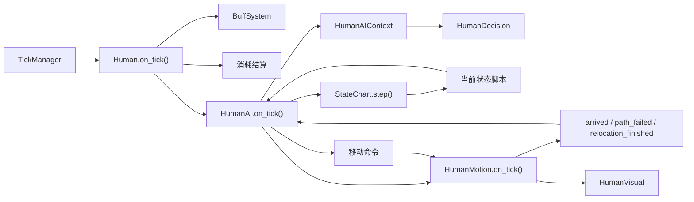

# 01 总体架构与职责

## 1. 当前基线

重构前的工作区有几个相互矛盾的事实，后续实现必须先统一它们。

| 事实 | 影响 |
| --- | --- |
| `Human.tscn` 已经挂了一个无参 `HumanAI` 节点 | 场景实例本身合法 |
| `Human.gd` 又执行 `HumanAI.new(self)` | 每个居民会产生两个 AI 概念，并触发 `_init` 参数错误 |
| `HumanMotion.gd` 已经存在 | 但 `Human.tscn` 没有 `Motion` 节点 |
| `StateChart` 已经挂进场景 | 但没有状态脚本、没有事件、没有每刻 `step()` |
| `Brain.gd`、`StatusBase.gd` 存在 | 没有实际调用方，不能继续扩展成第二套状态系统 |
| `GlobalEnum.HumanStatus` 存在 | 当前与场景状态节点不同步，不应成为第三份状态事实 |
| 旧 `HumanAI` 持有 `path`、`path_index` | 移动所有权仍混在 AI 中 |
| 旧 AI 进入工作站时没有统一切换 `in_building` | `HumanMotion` 的原子离站前提不完整 |

因此本次不是“在旧 AI 旁边再挂一个状态机”，而是把旧 AI 的决策、状态和移动
三部分拆开后替换原实现。

## 2. 组件边界

| 组件 | 唯一职责 | 明确不负责 |
| --- | --- | --- |
| `Human` | 居民数据、组件组合、每刻调度、对外转发脱困请求 | 目标评分、状态转换、具体移动 |
| `HumanAI` | 决策上下文、候选目标、目标承诺、状态机协调、事件分发 | 路径、位置、动画、Buff 计时 |
| `HumanDecision` | 纯函数式目标评分和排序 | 建筑扫描、状态切换、移动 |
| `HumanAIContext` | 本刻评分所需数据的只读快照 | 路径缓存、目标副作用 |
| `HumanStateBase` | 状态脚本公共绑定、调试状态上报 | 目标选择、全局决策 |
| 具体状态脚本 | 当前状态的进入、每刻、退出和状态专属事件 | 其他状态的逻辑 |
| `StateChart` | 状态拓扑、事件路由和单动作约束 | 游戏时间、目标评分、寻路 |
| `HumanMotion` | 路径规划、连续移动、出入口选择、脱困、原子离站 | 选择目标、判断工作资格、AI 状态 |
| `HumanVisual` | 动画、朝向、隐藏和显示 | 决定何时隐藏、决定去哪 |
| `BuffSystem` | Buff 计时、工作闸门、倍率汇总 | 中断状态机、直接移动 |
| `Building` / `WorkStation` | 等待刻数、建筑占用和站内名单 | 居民 AI 状态 |

可以把职责压缩成一句话：

> `Human` 提供身体和数据，`HumanAI` 决定做什么，`StateChart` 保证一次只做一件事，
> `HumanMotion` 执行怎么走，`HumanVisual` 表现结果。

## 3. 目标节点关系



`HumanAI` 是协调点，但不是所有实现的容器。状态脚本负责状态局部行为，
`HumanMotion` 负责所有空间变化，`HumanDecision` 保持无副作用。

## 4. 每刻调用顺序

固定顺序如下：

```text
TickManager.advance_tick()
└─ Human.on_tick()
   ├─ buff_system.on_tick()
   ├─ Human._consume()
   └─ HumanAI.on_tick()
      ├─ HumanAIContext.refresh()
      ├─ StateChart.step()
      │  └─ 当前状态 state_stepped
      ├─ 若有移动，则 HumanMotion.on_tick() 仅一次
      └─ 移动信号可能在 Motion.on_tick() 内同步触发状态转换
```

设计时不要颠倒两个顺序：

- 先 `StateChart.step()`，让状态决定本刻是否开始或结束动作。
- 再 `HumanMotion.on_tick()`，让本刻已经存在的路径推进一次。

这样可以保证居民在空闲状态完成决策后，本刻就能开始移动；也能保证同一刻不会
因为状态脚本和旧 AI 各推进一次而走两步。

### 4.1 为什么 `BuffSystem` 仍由 `Human` 驱动

Buff 是所有居民系统共享的基础结算，不属于状态机。`Human` 先推进 Buff 和消耗，
然后 AI 读取最新的 `can_work()`、速度倍率和资源量。这样 AI 不会在旧 Buff 数据上
做决策，也不需要自己维护 Buff 计时。

### 4.2 为什么动画信号由 `Human` 接线

`HumanMotion` 已经提供：

- `moving_changed(moving: bool)`
- `facing_changed(direction: Vector2)`

`Human._ready()` 可以把它们直接连接到 `HumanVisual.set_moving()` 和
`HumanVisual.set_facing()`。这样 `HumanAI` 既不用操作视觉，也不需要每刻重复设置
“正在走路”或“静止”。

## 5. 数据流

### 5.1 决策输入

`HumanAIContext.refresh()` 每次从居民和 Buff 读取：

- 当前水、食物。
- 每日耗水和耗食、Buff 汇总后的消耗倍率，以及 Buff 的逐刻直接扣减。
- 按有效消耗速度还能支撑多少刻。
- Buff 是否允许工作。
- 水、食物、工作三个目标权重倍率。

建筑扫描和路径选择不放进上下文快照。它们只在空闲决策真正选中候选目标时执行。
有效消耗速度必须使用：

```text
per_tick =
    daily_consume / TICKS_PER_DAY * BuffSystem.get_consume_multiplier()
    + BuffSystem.get_<resource>_drain_per_tick()
```

只使用基础日耗或只使用消耗倍率，都会让口渴、虚弱等状态下的紧迫度失真。

### 5.2 目标输出

`HumanDecision` 返回一个按优先级排序的目标列表，例如：

```text
[WATER, FOOD, WORK]
```

`HumanAI` 按顺序为每个目标寻找可达建筑：

- 找到就写入 `_goal` 和 `_target`，然后发送 `goal_selected`。
- 找不到就尝试下一项。
- 全部失败则继续空闲。

这样“水站不存在”不会让居民永久放弃其他可行目标。

### 5.3 状态输出

状态脚本不直接改居民坐标。它只调用 AI 提供的动作接口：

- `start_travel_to_current_target()`
- `complete_current_wait()`
- `enter_current_workstation()`
- `evaluate_work_interrupt()`
- `leave_work_now()`
- `begin_relocation()`
- `is_target_valid()`
- `send_event()`

每个动作接口再调用 `HumanMotion` 或 `WorkStation`。

## 6. 状态机为什么这样分层

采用两个复合层：

```text
Lifecycle
├─ Normal
│  ├─ Idle
│  ├─ Traveling
│  ├─ Waiting
│  ├─ Working
│  └─ LeavingWork
└─ Relocating
```

原因如下：

### 6.1 `Normal` 统一处理强制中断

新建筑把居民压住时，无论居民正在空闲、移动、等待还是工作，都必须暂停普通决策。
把 `relocation_requested` 转换放在 `Normal` 上，可以统一捕获冒泡事件。

`StateChart` 会 deferred 进入初始状态，而节点 `_ready()` 已经完成时初始状态仍可能未激活。
因此初始化窗口内的脱困请求必须由 `HumanAI` 暂存，等到 `_active_state_key` 非空后的
第一个 tick 再发送；仅检查 `state_chart.is_node_ready()` 会丢事件。

### 6.2 `Relocating` 与普通动作互斥

脱困不是移动目标，也不能与取水、取食或工作并行。把它放在 `Normal` 外，
从结构上保证互斥。

### 6.3 不在状态机里复制三种服务流程

`Traveling` 和 `Waiting` 通过当前 `Goal` 区分目的地。这样水、食物、工作共享：

- 路径失败退出。
- 目标失效退出。
- 到达入口后的等待计时。
- 决策承诺规则。

若为每个目标复制 `GoWater / GoFood / GoWork / Drink / Eat / Work`，转换数量会迅速
增加，且以后加入“休息”“就医”时还要继续复制。

### 6.4 为什么需要 `LeavingWork`

居民在工作站内部换目标时，`HumanMotion` 的路径规划起点不是居民当前坐标，
而是工作站的所有出入口。只有先确认到新目标的路径存在，才能原子离站。

`LeavingWork` 状态专门承担这段短暂流程：

- 成功：路径已经存在，转到 `Traveling` 继续走。
- 失败：居民仍在站内，先执行安全的无目标离站，再回到 `Idle`。

如果直接在 `Working -> Traveling` 转换中开始移动，寻路失败时很容易落入
“状态已经是 Traveling，但身体仍在站内”的矛盾。

## 7. 目标承诺与中断规则

目标评分回答“现在最想做什么”，状态机回答“是否允许改变当前承诺”。

| 当前动作 | 是否允许自由改目标 | 规则 |
| --- | --- | --- |
| `Idle` | 是 | 到决策刻后按候选顺序选择 |
| `Traveling` | 水/食物：否；工作：有条件 | 水/食物行程保持承诺；工作行程遇到工作闸门失效或紧急生存目标时可中断 |
| `Waiting` | 水/食物：否；工作：有条件 | 水/食物等待完成后补给；工作等待期间同样检查工作闸门和紧急生存目标 |
| `Working` | 有条件 | 工作闸门失效立即中断；生存目标超过阈值时中断；脱困立即中断 |
| `LeavingWork` | 否 | 只等待离站路线结果 |
| `Relocating` | 否 | 忽略普通目标，直到脱困结束 |

### 7.1 工作闸门

`BuffSystem.can_work()` 为 `false` 时：

- 空闲决策不能把工作放入候选列表。
- 正在前往或等待工作站时每刻检查，失效后停止当前路线并回空闲。
- 已在工作时每刻检查，必须立即离站并回空闲。
- 不能先选一个水下目标再等待路径，因为“继续在工作站里”本身已经违规。

### 7.2 生存中断

前往工作站、等待进站或已经工作时，水或食物变得紧急都可以中断工作目标。前往和等待
水站/食物站则保持当前承诺，避免在两个补给目标之间来回切换。为了避免在阈值附近反复进出工作站，
中断使用高于普通工作权重的倍率，例如 `1.15`。具体数值属于决策模块，不属于状态节点。

### 7.3 平手规则

平手必须显式定义。默认采用：

1. 水。
2. 食物。
3. 工作。

不能依赖 `if` 的书写顺序形成隐式规则，因为旧实现注释和实际平手行为曾经不一致。

## 8. 失败和清理规则

每个动作都必须有可退出的失败路径。

| 失败 | 处理 |
| --- | --- |
| 取水/取食路径不存在 | `Traveling -> Idle`，清空目标 |
| 工作路径不存在 | `Traveling -> Idle` |
| 工作站位失效 | 离开当前站，`Working -> Idle` |
| 前往/等待工作时工作闸门失效 | 停止移动，`Traveling/Waiting -> Idle`，清空目标 |
| 站内前往新目标失败 | `LeavingWork` 先安全离站，再到 `Idle` |
| 脱困无连续路径但有可走目标格 | `HumanMotion` 直接落到最近可走格并发出完成信号 |
| 脱困找不到任何可走格 | 返回失败并记录错误；不得把仍站在不可走格的居民当作脱困成功 |
| 居民节点无效 | 状态脚本停止推进，不继续写位置 |
| 目标建筑被移除 | 视为目标失效，停止移动并回空闲 |

任何失败都不能让居民永久停在 `Traveling`、`Waiting` 或 `LeavingWork`；同时也不能为了
退出状态而静默掩盖“居民仍在建筑内”的失败。

## 9. 正式接口

### 9.1 `HumanAI`

必须提供：

- `bind(host: Human) -> void`
- `on_tick() -> void`
- `request_relocation() -> void`
- `get_debug_snapshot() -> Dictionary`

建议提供：

- `signal state_changed(old_state: StringName, new_state: StringName)`
- `signal goal_changed(old_goal: int, new_goal: int)`
- `get_goal() -> int`
- `get_target() -> Building`

不再提供的旧接口：

- `HumanAI.new(host)`
- `enforce_work_gate()`
- `evict_out()`
- `get_speed_cells_per_tick()`
- 公开可写 `phase`
- 公开路径 `path` / `path_index`

### 9.2 `Human`

- `relocate_out()`：放置系统唯一入口，转发给 `HumanAI.request_relocation()`。
- `on_tick()`：只调用一次 AI。
- `set_world_visibility(visible: bool)`：工作站进出的语义化显隐入口；AI 和 Motion 不直接
  调用 `hide()` / `show()`。
- `motion`、`ai` 为场景组件引用。

### 9.3 `HumanMotion`

必须保证：

- `move_to_building()`、`move_to_cell()`、`move_to_nearest_building()` 等会创建移动状态的
  公开命令失败时发出一次 `path_failed`。`find_nearest_building()`、`get_ticks_to_building()`
  是查询，不改变移动状态，不发该信号。
- `relocate_to_nearest_walkable()` 是脱困命令，用返回值报告是否已确认安全或成功提交路线；
  成功结束时发 `relocation_finished`，寻路失败不冒充普通移动的 `path_failed`。
- 成功开始移动时发出一次 `movement_started`。
- 路径完成时发出 `arrived`。
- 脱困成功结束时，包括“本来已站在可走格”的 no-op，也发出一次
  `relocation_finished`。
- 脱困无法确认安全时不得发 `relocation_finished`；`RelocatingState` 记录失败并发送
  `relocation_failed` 退出状态，便于日志和测试识别。
- 从不直接修改 AI 状态。
- 不自行运行 `_process`。

### 9.4 调试快照

建议返回：

```gdscript
{
    "goal": 2,
    "goal_name": &"FOOD",
    "state": &"traveling",
    "target": "无限取食站",
    "target_valid": true,
    "water_ticks_left": 412.5,
    "food_ticks_left": 208.0,
    "can_work": true,
    "moving": true,
    "path_size": 7,
    "relocating": false,
    "wait_left": 0,
}
```

标签、测试和 UI 只依赖该快照，不再读取 AI 内部字段。

## 10. 类与文件所有权

```text
Scripts/Human/
├─ Human.gd
├─ HumanMotion.gd
├─ HumanVisual.gd
└─ HumanAI/
   ├─ HumanAI.gd
   ├─ HumanAIContext.gd
   ├─ HumanDecision.gd
   ├─ HumanStateBase.gd
   └─ States/
      ├─ IdleState.gd
      ├─ TravelingState.gd
      ├─ WaitingState.gd
      ├─ WorkingState.gd
      ├─ LeavingWorkState.gd
      └─ RelocatingState.gd
```

`Brain.gd` 和 `StatusBase.gd` 是未接线的试验代码。迁移完成后若没有调用方，
应删除，避免出现第二套状态注册机制。

## 11. 不采用的方案

| 方案 | 不采用原因 |
| --- | --- |
| 在旧 `HumanAI.gd` 中继续增加 `match phase` | 决策、状态、移动继续耦合，失败路径难保证 |
| 每个居民在运行时 `new()` 状态机脚本 | 丢失场景配置，编辑器不可直接检查 |
| 把状态机放到 Autoload | 状态属于每个居民，不属于全局 |
| 使用插件帧级 `delay_in_seconds` 计等待 | 游戏按刻推进，帧率和倍速会破坏逻辑 |
| 为水量、食物量建立并行状态机 | 资源是上下文数据，不是两个并行动作 |
| 在 AI 中保存路径并调用 `WorldGrid` | 移动所有权重新泄漏回 AI |
| 在状态脚本中直接改 `Human.position` | 绕过原子离站和视觉一致性 |
| 依赖表达式守卫读取大量实时数据 | 状态转换更难追踪，测试需要同步表达式属性 |

## 12. 本章验收点

读完本章后，实施者应能回答：

- 为什么状态机挂在 `HumanAI` 下面，而不是 `Human` 或 Autoload 下面。
- 为什么每刻先推进状态机，再推进移动。
- 为什么水、食物、工作不各自复制完整的 Go/Do 状态。
- 为什么工作站内换目标需要 `LeavingWork`。
- 为什么 `HumanMotion` 失败必须发出信号，不能让 AI 猜测。
- 为什么旧 `Brain.gd` 和 `GlobalEnum.HumanStatus` 不能成为第三份状态来源。
