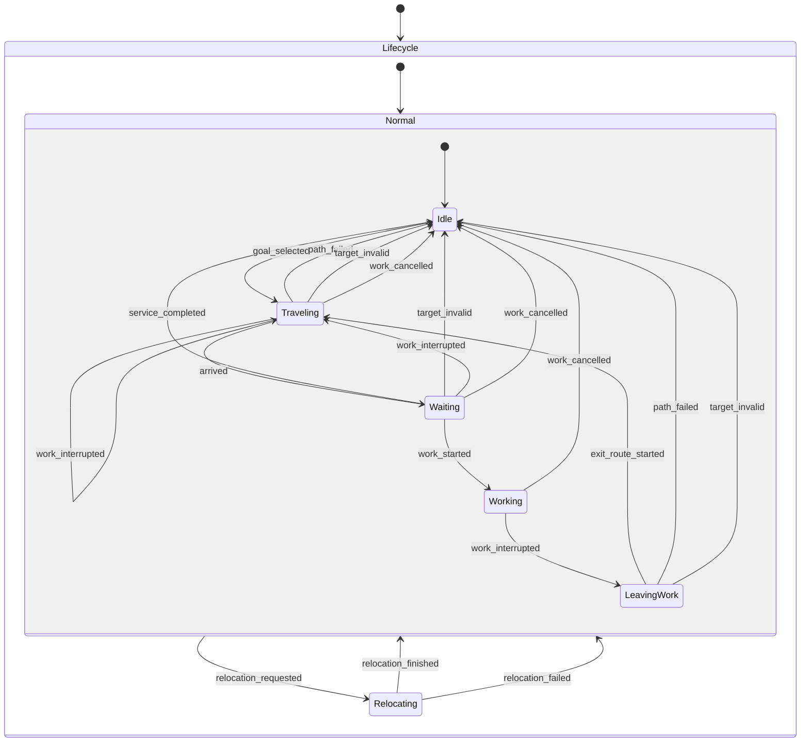
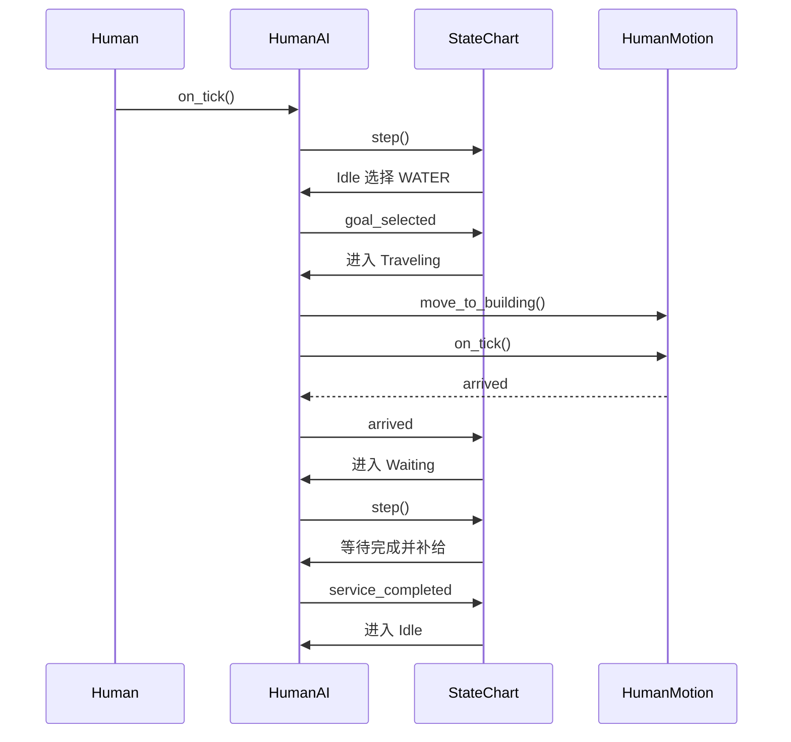
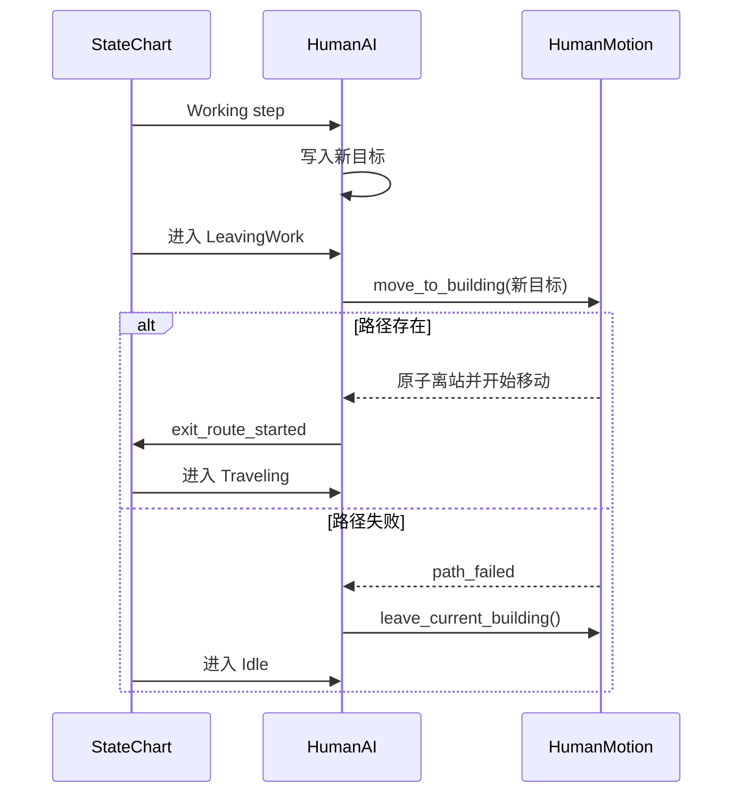
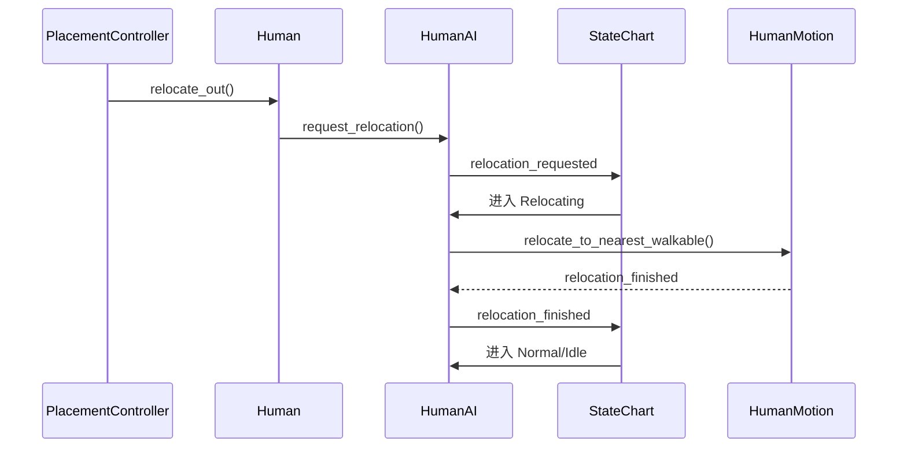

# 02 状态机节点与配置

## 1. 最终状态拓扑

状态机使用 `godot_state_charts`，但所有模拟推进由 `StateChart.step()` 控制。
不使用帧级 `state_processing`，也不使用 `delay_in_seconds` 作为游戏等待。



## 2. 节点树

目标节点树如下。名称建议保持不变，便于测试和 Godot 远程调试器定位。

```text
HumanRoot                        Node2D     Human.gd
├─ BuffSystem                    Node       BuffSystem.gd
├─ Visual                        Node2D     HumanVisual.gd
├─ Motion                        Node       HumanMotion.gd
└─ HumanAI                       Node       HumanAI.gd
   └─ StateChart                 Node       state_chart.gd
      └─ Lifecycle               Node       compound_state.gd
         ├─ Normal               Node       compound_state.gd
         │  ├─ Idle              Node       IdleState.gd
         │  │  └─ ToTravelingOnGoalSelected       Transition
         │  ├─ Traveling         Node       TravelingState.gd
         │  │  ├─ ToWaitingOnArrived              Transition
         │  │  ├─ ToIdleOnPathFailed              Transition
         │  │  ├─ ToIdleOnTargetInvalid           Transition
         │  │  ├─ ToTravelingOnWorkInterrupted    Transition
         │  │  └─ ToIdleOnWorkCancelled           Transition
         │  ├─ Waiting           Node       WaitingState.gd
         │  │  ├─ ToIdleOnServiceCompleted        Transition
         │  │  ├─ ToWorkingOnWorkStarted          Transition
         │  │  ├─ ToIdleOnTargetInvalid           Transition
         │  │  ├─ ToTravelingOnWorkInterrupted    Transition
         │  │  └─ ToIdleOnWorkCancelled           Transition
         │  ├─ Working           Node       WorkingState.gd
         │  │  ├─ ToLeavingWorkOnWorkInterrupted  Transition
         │  │  └─ ToIdleOnWorkCancelled            Transition
         │  ├─ LeavingWork       Node       LeavingWorkState.gd
         │  │  ├─ ToTravelingOnExitRouteStarted   Transition
         │  │  ├─ ToIdleOnPathFailed              Transition
         │  │  └─ ToIdleOnTargetInvalid           Transition
         │  └─ ToRelocatingOnRelocationRequested  Transition
         └─ Relocating           Node       RelocatingState.gd
            ├─ ToNormalOnRelocationFinished       Transition
            └─ ToNormalOnRelocationFailed         Transition
```

### 2.1 为什么 `Motion` 不在 `HumanAI` 下面

`HumanMotion` 是居民身体组件，不是 AI 的内部状态。它和 `Visual`、`BuffSystem`
同级更符合职责边界，也方便以后测试直接替换移动组件。

`HumanAI` 只保存引用，不拥有路径。

### 2.2 为什么 `StateChart` 在 `HumanAI` 下面

- 状态图是 AI 的内部实现。
- AI 可以统一绑定状态脚本、推进 `step()`、接收移动信号。
- 外部测试不需要进入状态机内部，只读取 AI 调试快照。
- 每个居民实例都有自己的状态图实例。

### 2.3 不要使用 `ParallelState`

本版只有一个主动作。水量、食物量和 Buff 是决策输入，不是并行执行的主动作。
使用并行状态会让“正在取水”和“正在上班”同时可能为真，破坏单动作约束。

以后若加入“移动中持续播放饥饿表现”等独立表现层，可以单独使用表现状态机，
但不要和正式行为状态放在同一层并行推进。

## 3. StateChart 设置

| 属性 | 值 | 原因 |
| --- | --- | --- |
| `track_in_editor` | `true` | 可在编辑器远程调试器中观察状态 |
| `warn_on_sending_unknown_events` | `true` | 拼错事件名时立即发现 |
| `initial_expression_properties` | 空 | 本设计不使用表达式守卫 |
| 子节点数量 | 恰好 1 个 | 插件根状态约束 |
| 直接子节点 | `Lifecycle` | 统一挂载状态层次 |

不要在 `StateChart` 节点本身写 `HumanAI.gd`。`StateChart` 节点必须使用插件脚本，
AI 协调逻辑写在父节点 `HumanAI.gd`。

## 4. 复合状态设置

### 4.1 `Lifecycle`

| 属性 | 值 |
| --- | --- |
| 脚本 | `compound_state.gd` |
| `initial_state` | `NodePath("Normal")` |

`Lifecycle` 是状态机唯一根状态。它把普通生活流程和脱困流程分开。

### 4.2 `Normal`

| 属性 | 值 |
| --- | --- |
| 脚本 | `compound_state.gd` |
| `initial_state` | `NodePath("Idle")` |

`Normal` 本身不执行动作，只提供两个公共约束：

1. 进入普通生活区域时默认回 `Idle`。
2. 捕获任何子状态冒泡上来的 `relocation_requested`。

## 5. 原子状态设置

所有动作状态都使用各自的脚本，脚本最终继承 `HumanStateBase`，
`HumanStateBase` 再继承 `atomic_state.gd`。

| 状态 | 脚本 | 职责 |
| --- | --- | --- |
| `Idle` | `IdleState.gd` | 清空目标和路径，按决策周期选择新目标 |
| `Traveling` | `TravelingState.gd` | 确认目标有效；工作行程额外检查工作闸门和生存中断 |
| `Waiting` | `WaitingState.gd` | 按建筑等待刻数递减；工作等待额外检查工作闸门和生存中断 |
| `Working` | `WorkingState.gd` | 进入工作站，检查工作闸门和生存中断 |
| `LeavingWork` | `LeavingWorkState.gd` | 原子离站并衔接已有新路径 |
| `Relocating` | `RelocatingState.gd` | 暂停所有普通目标，执行脱困 |

状态节点不要设置自定义 `process_mode`。插件会根据状态是否活动自动开关处理能力。

## 6. 转换节点设置

所有转换都遵守：

| 属性 | 值 |
| --- | --- |
| 脚本 | `transition.gd` |
| `event` | 本文列出的 `StringName` |
| `guard` | 空 |
| `delay_in_seconds` | `"0.0"` |
| 子节点 | 无 |

不要在转换节点下挂脚本或子节点。条件判断放在当前状态脚本或 AI 协调逻辑里，
转换只表达已经发生的事实。

### 6.1 普通生活转换

| 源节点 | 转换节点 | `event` | 目标节点 | `to` 的 Inspector 值 |
| --- | --- | --- | --- | --- |
| `Idle` | `ToTravelingOnGoalSelected` | `goal_selected` | `Traveling` | `../../Traveling` |
| `Traveling` | `ToWaitingOnArrived` | `arrived` | `Waiting` | `../../Waiting` |
| `Traveling` | `ToIdleOnPathFailed` | `path_failed` | `Idle` | `../../Idle` |
| `Traveling` | `ToIdleOnTargetInvalid` | `target_invalid` | `Idle` | `../../Idle` |
| `Traveling` | `ToTravelingOnWorkInterrupted` | `work_interrupted` | `Traveling` | `../../Traveling` |
| `Traveling` | `ToIdleOnWorkCancelled` | `work_cancelled` | `Idle` | `../../Idle` |
| `Waiting` | `ToIdleOnServiceCompleted` | `service_completed` | `Idle` | `../../Idle` |
| `Waiting` | `ToWorkingOnWorkStarted` | `work_started` | `Working` | `../../Working` |
| `Waiting` | `ToIdleOnTargetInvalid` | `target_invalid` | `Idle` | `../../Idle` |
| `Waiting` | `ToTravelingOnWorkInterrupted` | `work_interrupted` | `Traveling` | `../../Traveling` |
| `Waiting` | `ToIdleOnWorkCancelled` | `work_cancelled` | `Idle` | `../../Idle` |
| `Working` | `ToLeavingWorkOnWorkInterrupted` | `work_interrupted` | `LeavingWork` | `../../LeavingWork` |
| `Working` | `ToIdleOnWorkCancelled` | `work_cancelled` | `Idle` | `../../Idle` |
| `LeavingWork` | `ToTravelingOnExitRouteStarted` | `exit_route_started` | `Traveling` | `../../Traveling` |
| `LeavingWork` | `ToIdleOnPathFailed` | `path_failed` | `Idle` | `../../Idle` |
| `LeavingWork` | `ToIdleOnTargetInvalid` | `target_invalid` | `Idle` | `../../Idle` |

### 6.2 公共强制转换

| 源节点 | 转换节点 | `event` | 目标节点 | `to` 的 Inspector 值 |
| --- | --- | --- | --- | --- |
| `Normal` | `ToRelocatingOnRelocationRequested` | `relocation_requested` | `Relocating` | `../../Relocating` |
| `Relocating` | `ToNormalOnRelocationFinished` | `relocation_finished` | `Normal` | `../../Normal` |
| `Relocating` | `ToNormalOnRelocationFailed` | `relocation_failed` | `Normal` | `../../Normal` |

`ToRelocatingOnRelocationRequested` 是 `Normal` 的直接子节点，不是每个状态各复制一份。
当 `Normal` 的子状态没有消费该事件时，事件冒泡到 `Normal`，从而统一中断任何普通动作。

## 7. 事件协议

### 7.1 事件名

| 事件 | 发送者 | 语义 |
| --- | --- | --- |
| `goal_selected` | `IdleState` | AI 已经写入有效目标，可以开始旅程 |
| `arrived` | `HumanMotion.arrived` 转发 | 普通路径走完 |
| `path_failed` | `HumanMotion.path_failed` 转发 | 移动命令没有找到路径 |
| `target_invalid` | 当前状态脚本 | 目标被拆除、类型不符或状态不一致 |
| `service_completed` | `WaitingState` | 水或食物已经补给完成 |
| `work_started` | `WaitingState` | 工作入口等待完成，可进入站内状态 |
| `work_interrupted` | `TravelingState`、`WaitingState`、`WorkingState` | 工作目标被紧急生存需求打断，AI 已写入新的水/食物目标 |
| `work_cancelled` | `TravelingState`、`WaitingState`、`WorkingState` | 工作资格或站位失效，停止工作目标并回空闲 |
| `exit_route_started` | `LeavingWorkState` | 从站内到新目标的路径已经原子建立 |
| `relocation_requested` | `HumanAI` | 放置系统请求脱困 |
| `relocation_finished` | `HumanMotion` 转发 | 脱困移动成功完成，或确认已安全且无需移动 |
| `relocation_failed` | `RelocatingState` | 没有可确认的安全结果；记录错误后退出脱困状态 |

事件名使用 `StringName` 常量，不在多个脚本中直接写字符串。

### 7.2 事件不携带参数

例如 `goal_selected` 不带目标类型。目标已经在发送事件前写入：

```gdscript
_goal = selected_goal
_target = selected_building
state_chart.send_event(EVENT_GOAL_SELECTED)
```

这样状态图只描述控制流，复杂数据仍由强类型脚本保存。

### 7.3 转换顺序

插件对同一状态内的转换采用“先匹配先消费”。本设计每个事件在每个活动状态上最多
配置一个转换，因此不依赖转换排序。若以后出现同事件多目标，必须增加显式守卫，
并且写测试验证顺序。

## 8. 每个状态的行为

### 8.1 `Idle`

进入时：

- `HumanMotion.stop()`，清除任何遗留路径。
- 清空目标建筑。
- 设置“下一次决策立即执行”。

每刻：

- 检查决策周期。
- 完成一次纯评分。
- 按候选顺序寻找可达建筑。
- 成功时写入目标并发送 `goal_selected`。
- 没有候选时保持 `Idle`。

不在 `Idle` 中扫描建筑以外的世界数据。

### 8.2 `Traveling`

进入时：

- 若已经从 `LeavingWork` 建立了路径，则继续使用，不重复寻路。
- 否则调用 `start_travel_to_current_target()`。

每刻：

- 检查目标是否仍然有效。
- 若当前目标是 `WORK`，先检查工作闸门；失效时清空目标并发送 `work_cancelled`。
- 若当前目标是 `WORK`，按决策周期检查生存目标；达到中断阈值且找到可达目标时，
  写入新目标并发送 `work_interrupted`，通过 `Traveling -> Traveling` 重新进入，
  退出时会停止旧路线，进入时会从当前位置规划新路线。
- 当前目标是水或食物时保持承诺，不因另一个生存目标变化而中途改道。
- 路径推进由 `HumanAI` 在状态机之后统一调用。

到达时：

- `HumanMotion.arrived` 触发 `arrived`。
- 状态转换到 `Waiting`。
- `Waiting` 从目标建筑读取等待刻数。

退出时：

- 停止未完成路径。
- 不直接修改工作站占用或居民显示。

### 8.3 `Waiting`

进入时：

- 读取 `target.get_wait_ticks()`。
- 把等待值保存在状态脚本内部，不放进 AI 公共字段。

每刻：

- 目标无效时发送 `target_invalid`。
- 当前目标是 `WORK` 时，先检查工作闸门和生存中断，规则与 `Traveling` 相同；
  中断后发送 `work_interrupted`，从 `Waiting` 进入 `Traveling` 规划新路线。
- 等待刻数减一。
- 水或食物完成后调用 AI 补给接口并发送 `service_completed`。
- 工作完成后发送 `work_started`，进入 `Working` 后再真正登记站内状态。

`Waiting` 不使用 `Timer`、`create_tween()` 或插件延迟转换。

### 8.4 `Working`

进入时：

- 目标必须是已放置的 `WorkStation`。
- 调用 `WorkStation.enter(human)`。
- 设置 `human.in_building = station`。
- 调用 `Human.set_world_visibility(false)` 隐藏居民。

每刻：

- 目标无效：安全离站，发送 `work_cancelled`。
- `BuffSystem.can_work() == false`：立即安全离站，发送 `work_cancelled`。
- 生存目标超过中断阈值：写入新目标，发送 `work_interrupted`。
- 否则继续工作。

退出时：

- 不自行离站。普通离站由 `work_cancelled` 的发送方先执行；
  换目标由 `LeavingWork` 原子处理；强制脱困由 `Relocating` 处理。

### 8.5 `LeavingWork`

进入时：

- 调用 `start_travel_to_current_target()`。
- 成功：路径已经建立，居民已经原子离站，发送 `exit_route_started`。
- 失败：`HumanMotion` 发出 `path_failed`，状态回到 `Idle`。

退出时：

- 若 `human.in_building` 仍然有效，调用 `leave_current_building()` 做安全清理。
- 不停止成功建立的移动路径。

这个状态通常只存在很短时间，但它把“站内动作”和“站外移动”之间的原子边界
明确表达出来。

### 8.6 `Relocating`

进入时：

- 清空普通目标和等待值。
- 调用 `motion.relocate_to_nearest_walkable()`。
- 若命令直接返回失败，先尝试安全离站，记录错误，再发送 `relocation_failed`。

每刻：

- 不做目标评分。
- 由 AI 在状态机之后推进脱困路径。

完成时：

- `HumanMotion.relocation_finished` 触发转换。
- 重新进入 `Normal`，默认落到 `Idle`。
- `Idle` 清空脱困标记，下一 tick 重新决策。

## 9. 动作时序

### 9.1 正常取水/取食



### 9.2 工作被生存需求中断



### 9.3 脱困



## 10. 在 Godot 编辑器中的搭建步骤

### 10.1 重建居民场景

1. 打开 `Scenes/Human/Human.tscn`。
2. 保留 `BuffSystem`、`Visual`。
3. 在根节点下新增 `Motion`，挂 `HumanMotion.gd`。
4. 保留根节点下唯一的 `HumanAI`，挂重写后的 `HumanAI.gd`。
5. 把现有 `StateChart` 移动为 `HumanAI/StateChart`。
6. 确认 `HumanAI` 只有一个状态图子节点。

### 10.2 重建状态层次

1. 把原 `StateChart/CompoundState` 重命名为 `Lifecycle`。
2. 把 `Lifecycle.initial_state` 设为 `Normal`。
3. 在 `Lifecycle` 下新增 `Normal` 复合状态。
4. 把 `Normal.initial_state` 设为 `Idle`。
5. 在 `Normal` 下新增六个动作状态。
6. 在 `Lifecycle` 下、`Normal` 同级新增 `Relocating`。
7. 删除旧没有完整转换的 `GoWork`、`GoEat`、`GoDrink` 等占位节点。

### 10.3 挂状态脚本

按第 5 节表格为每个原子状态挂脚本。不要把所有状态都继续使用
`atomic_state.gd`，否则状态进入时没有项目行为。

### 10.4 添加转换

1. 转换必须是源状态的直接子节点。
2. `event` 填表格中的值。
3. `guard` 留空。
4. `delay_in_seconds` 填 `0.0`。
5. `to` 填表格中的相对 `NodePath`。
6. 检查编辑器所有状态和转换没有 configuration warning。

### 10.5 验证 NodePath

转换目标是相对转换节点自身解析的。最容易写错的是跨复合状态：

| 转换位置 | 前往同级状态 | 正确路径 |
| --- | --- | --- |
| `Idle/Transition` | `Traveling` | `../../Traveling` |
| `Normal/Transition` | `Relocating` | `../../Relocating` |
| `Relocating/Transition` | `Normal` | `../../Normal` |

不要根据源状态节点位置填写，而要根据转换节点位置填写。

## 11. 插件使用红线和陷阱

### 11.1 不用帧级处理

`StateChartState.state_processing` 和 `state_physics_processing` 是现实帧信号。
居民行为必须使用 `state_stepped`，由 AI 每游戏刻调用 `step()`。

### 11.2 不用延迟转换做等待

`delay_in_seconds` 依赖真实 `_process(delta)`。当游戏切换 1x、20x 或暂停时，
等待时间和游戏刻会不一致。例如 2 刻等待在不同倍速下不能变成“固定两帧”。

### 11.3 不发送未知事件

开启 `warn_on_sending_unknown_events` 后，拼错事件会输出警告。无头验证必须检查
日志里没有 `State chart does not have an event`。

### 11.4 不在 `_ready()` 直接发送事件

插件要求状态图 ready 后才能 `send_event()`。本设计不在 `_ready()` 发事件；
第一次普通事件发生在 `HumanAI.on_tick()` 后的状态 step 中。初始化窗口内收到的
脱困请求必须先暂存在 AI，等初始状态真正激活后再于下一个 tick 发送；
`state_chart.is_node_ready()` 为 `true` 不代表 deferred 初始状态已进入。

### 11.5 不把自动转换和事件转换混用

空 `event`、空 `guard` 的转换会在进入状态时立即触发。若以后加入纯自动转换，
必须非常清楚地证明它不会形成循环，并在本表补充顺序。本版不配置自动转换。

### 11.6 不直接读取插件内部 `_state`

调试状态通过 `HumanStateBase` 进入时上报给 `HumanAI`。不要在其他脚本中读取
`StateChart._state`、`active` 链或私有转换字段。

## 12. 状态机配置验收清单

- [ ] `HumanAI` 下只有一个 `StateChart`。
- [ ] `StateChart` 下只有一个 `Lifecycle`。
- [ ] `Lifecycle.initial_state == Normal`。
- [ ] `Normal.initial_state == Idle`。
- [ ] 六个动作状态都挂了对应脚本。
- [ ] 每个转换都有非空 `event`。
- [ ] 所有转换 `guard` 为空。
- [ ] 所有转换 `delay_in_seconds == "0.0"`。
- [ ] 每个转换的目标路径可解析，编辑器无警告。
- [ ] `Normal` 捕获 `relocation_requested`。
- [ ] `Relocating` 的成功和失败事件都能回到 `Normal`。
- [ ] `Traveling` 和 `Waiting` 都能处理 `work_cancelled` 与 `work_interrupted`。
- [ ] 没有脚本连接 `state_processing` 或 `state_physics_processing`。
- [ ] 没有状态脚本自行调用 `StateChart.step()`。
- [ ] `StateChart.step()` 的唯一调用点在 `HumanAI.on_tick()`。
