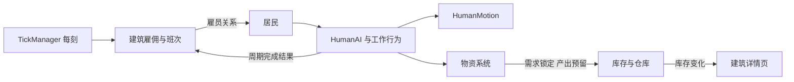

# 总体架构与职责

## 1. 当前代码基线

本设计基于以下现有事实：

- `TickManager.advance_tick()` 先更新建筑，再更新居民，最后广播刻事件。
- `HumanAI` 当前每 5 刻决策一次，并通过 `HumanMotion.find_nearest_building()`
  选择最近的 `WorkStation`。
- `WorkStation` 当前只有 `occupants`，表示物理站内人数，没有雇佣、班次、产出或库存。
- `Human.in_building` 当前表示居民所在的物理建筑，不能继续等同于“正在工作”。
- `Human.age` 与 `Human.age_status` 当前由放置和测试代码直接设置，没有自动年龄增长。
- `World.WAIT_PLACE` 已存在但未使用，`HumanMotion.move_to_cell()` 目前只会停在格子中心。
- `BuildingDetailPanel` 当前只渲染静态文本行，并且每刻整体重建内容。
- `Building.remove()` 仍是占位实现，`Human.die()` 目前直接释放节点，二者都没有雇佣或库存清理。
- 当前仓库没有物品、库存、容量、锁定或预留实现。

相关代码入口：

- [TickManager.gd](../../../Scripts/Core/TickManager.gd)
- [HumanAI.gd](../../../Scripts/Human/HumanAI/HumanAI.gd)
- [HumanMotion.gd](../../../Scripts/Human/HumanMotion.gd)
- [WorkStation.gd](../../../Scripts/Building/WorkStation.gd)
- [BuildingDetailPanel.gd](../../../Scripts/UI/BuildingDetailPanel.gd)
- [World.gd](../../../Scripts/World/World.gd)

## 2. 设计目标

本轮新增四个相互独立的概念：

1. **雇佣关系**：建筑与居民之间的归属关系。
2. **班次状态**：当前时刻是否允许开始新工作周期。
3. **工作周期**：一次完整、可结算、可回滚的劳动事务。
4. **物资事务**：物品数量、锁定、消耗、产出和容量预留。

必须避免把这些概念合并成一个“正在工作的工人列表”：

- 建筑知道雇员名单，但不知道雇员当前在哪，也不需要知道。
- 建筑不轮询居民是否正在劳动。
- 居民的工作行为向库存系统提交物品操作，向建筑提交工作结果。
- 物理位置仍只由 `Human.position`、`Human.in_building` 和 `HumanMotion` 表达。

## 3. 组件职责

| 组件 | 负责 | 不负责 |
| --- | --- | --- |
| 建筑雇佣能力 | 目标人数、最大人数、资格、雇员名单、补招、解雇 | 居民位置、路径、工作过程 |
| 建筑工作配置 | 班次、工作类型、可选运行阈值、自带库存 | 计算统一效率、维护活动工人集合 |
| 居民 | 雇主引用、自身需求、水食物消耗、组件调度 | 库存全局规则、建筑招聘策略 |
| 居民工作行为 | 一个居民的具体准备、周期、需求、产出和上报 | 招聘、库存全局一致性、路径实现 |
| `HumanAI` | 目标选择、动作状态、班次检查、硬中断协调 | 具体库存记账、直接改居民位置 |
| `HumanMotion` | 路径、连续移动、出入口、原子离站和脱困 | 选择工作、判断物品是否可消费 |
| 物资系统 | 物品定义、库存、锁定、空间预留、清算 | 居民 AI、建筑班次和路径选择 |
| 建筑自带库存 | 本建筑产出和可取出物品的本地库存 | 非本建筑物品的普通存入 |
| 外部仓库 | 通用物资存储和自动清算目的地 | 雇佣居民、生产规则 |

## 4. 数据流

建筑先更新，因此招聘、资格清理和班次信息在本刻居民决策前已经准备完成。
工作周期内的物品操作由居民在之后调用物资系统完成，建筑不参与逐刻位置或工作状态同步。

## 5. 每刻顺序建议

1. `TickManager` 按注册顺序更新建筑。
2. 建筑复检雇员资格，处理目标人数不足和超额。
3. 建筑提供本刻班次查询。
4. 居民推进 Buff、水和食物消耗。
5. `HumanAI` 根据雇主、班次、生存需求和当前动作做决策。
6. 工作行为推进准备或锁定工作周期。
7. 工作周期完成或中断时，通过物资系统原子结算。
8. 结算成功后向建筑提交工作结果。
9. 广播 `tick_advanced`，跨天时广播 `day_advanced`。

建筑的 `on_tick()` 不得读取居民路径或位置，也不得为了计算产出而维护一份
“谁正在工作”的并行名单。

## 6. 所有权与唯一写入口

### 6.1 雇佣关系

- `Human` 最多保存一个有效雇主引用。
- 建筑雇员名单是雇佣关系的集合事实。
- 招聘和解雇必须经过同一个受控入口，同步更新居民和建筑两侧。
- 不允许 UI、AI、建筑生命周期回调各自直接拼接半个关系。

### 6.2 移动

- `HumanMotion` 仍是唯一移动实现。
- 工作行为不得直接写 `Human.position`、路径或路径索引。
- 特殊工作模式需要新目的地能力时，应先扩展 `HumanMotion` 的语义接口。

### 6.3 库存

- 所有物品数量和预留状态以物资系统为准。
- 建筑自带库存只是挂在建筑上的库存实例，不是另一套库存规则。
- 物品锁定、容量预留和自动清算不能由工作行为自行复制实现。

### 6.4 工作结果

- 只有工作周期成功结算后，建筑才接收一次工作结果。
- 结果应包含产出、需求消耗和必要的来源信息。
- 建筑可以按自身规则使用结果更新库存、功能或显示，但不据此反推居民位置。

## 7. 状态机边界

现有状态机继续保证“同一居民同一时间只有一个主动作”。需要调整的是工作阶段语义：

- `Waiting` 仍可用于建筑入口等待和取水、取食流程。
- `Working` 不能再默认表示“进入建筑并隐藏”。
- 工作周期需要明确区分准备阶段和锁定阶段。
- 锁定阶段内，普通生存中断和工作时间结束不能触发离开。
- 硬中断仍必须能够退出周期，并保证库存和显示状态被清理。

是否新增独立状态节点由实现决定，但以下事实必须只有一个来源：

- 当前是否处于锁定周期。
- 当前周期的剩余时间。
- 已锁定的工作需求和已预留的产出空间。
- 周期被完成还是被取消。

## 8. 生命周期

以下事件都会影响雇佣或物资：

- 建筑放置完成。
- 建筑退出场景树或被删除。
- 居民被解雇、失去资格或死亡。
- 仓库被删除。
- 工作周期完成、取消或路径失败。

建筑退出和居民退出不能只做 `TickManager` 注销。还必须释放雇佣关系、取消相关周期、
释放锁定和空间预留，并按物资系统规则处理所有者物品。

## 9. 非目标

- 不为不同职业建立岗位模型。
- 不让建筑统一计算所有工作的效率。
- 不在本版实现树木、木材或砍伐进度。
- 不把建筑自带库存变成必须能力。
- 不通过帧级 `_process` 驱动工作、班次或库存。
